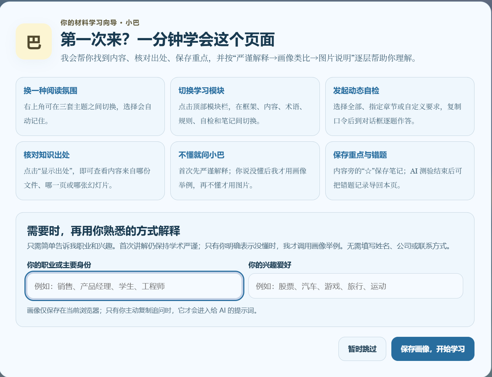
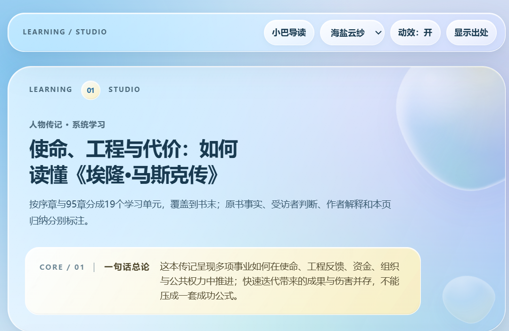
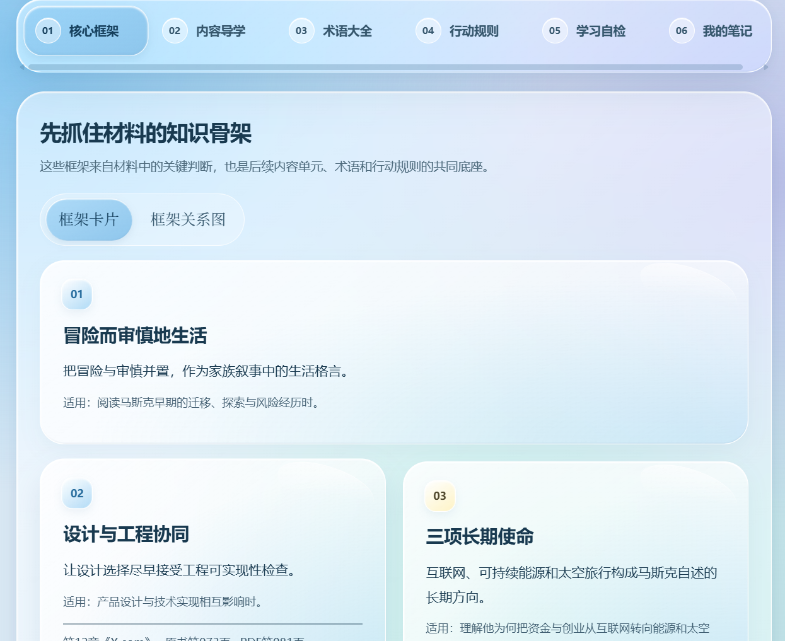
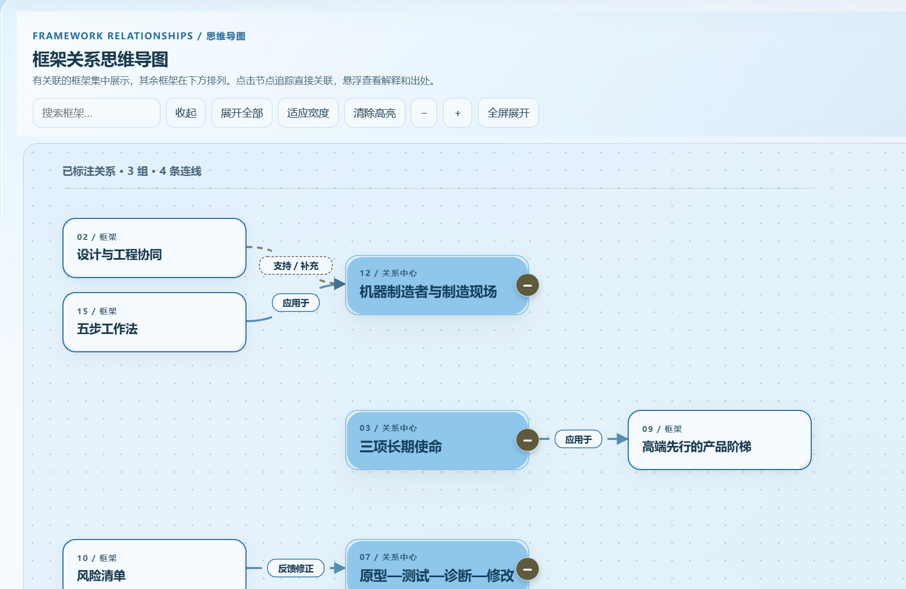
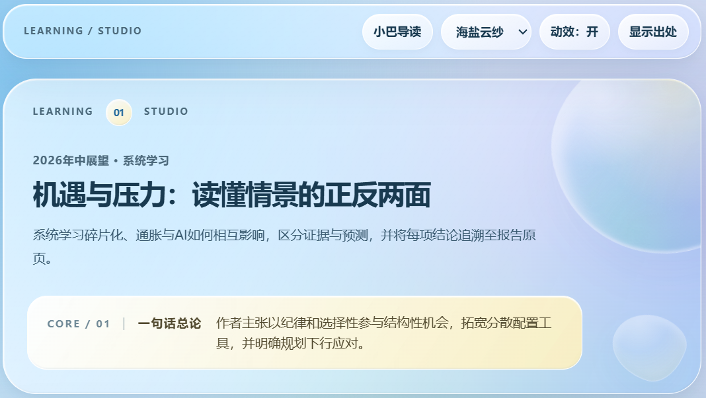
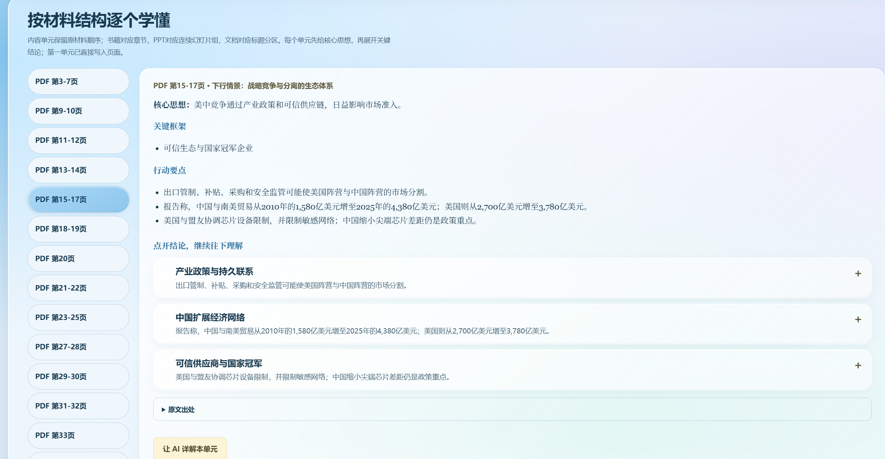
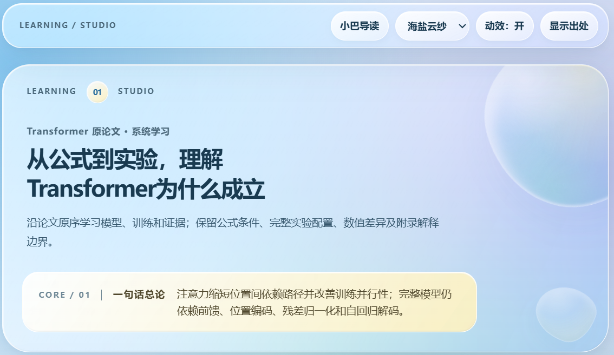
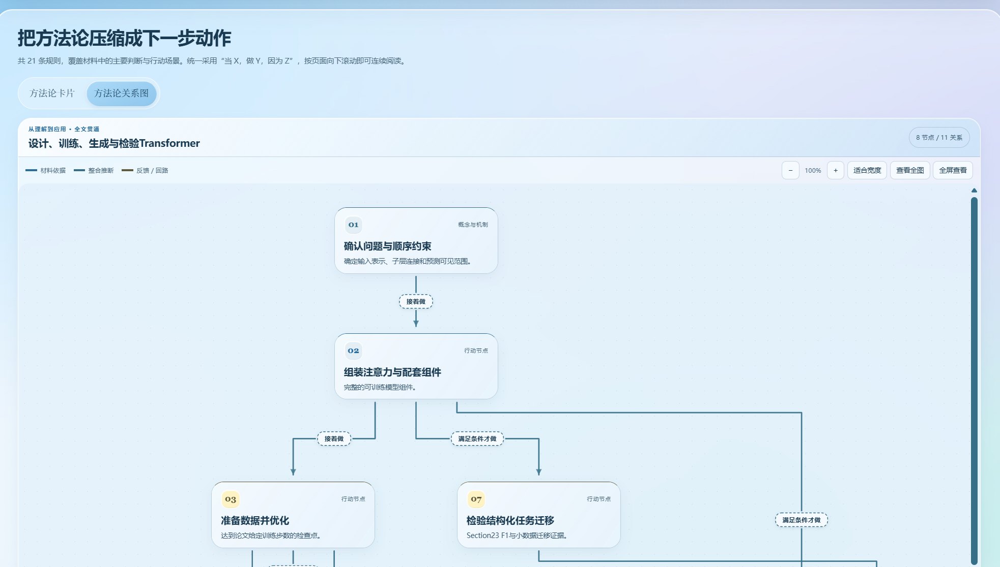

[English](README.md) · **中文**

# learn-from-materials


> 将书籍、PDF、PPT、Word、网页与多份资料转化为可追溯知识库、交互式学习网页和同源生成的 Markdown。


`learn-from-materials` 是一个基于开放 Agent Skills 规范的跨 Agent 学习 Skill。系统学习强调完整阅读；快速了解提炼核心主线。两种模式均要求出处可核验、材料事实与模型补充分离，并采用离线优先和最小权限。

它适用于能够读取文件、运行本地命令并识别 `SKILL.md` 的 Agent 环境，例如 WorkBuddy、Codex、Claude Code 和 GitHub Copilot CLI。纯聊天环境如果不能访问文件系统或执行 Python，只能使用其中的部分提示流程，不能完成材料提取、覆盖校验和 HTML 渲染。


## 主要能力

### 贯穿全文的方法论

先提炼材料的中心问题和目标，再将论证、框架与行动规则组织为完整结构。支持主流程、决策分支、因果与层级关系，以及有依据的反馈回路；不限定步骤数量，不把所有材料强套成八步流程。整体视图不按节点数量拆组，点击节点可查看输入、动作、产出、检查条件、关联学习单元与出处。

整体结构单独保存为 `methodology.json` / `methodology.md`，明确区分原文方法与全文整合。“一键使用方法论”默认携带整套结构，让 AI 定位用户的问题入口并按条件推进；仍可选择单张卡片。

内容导学支持核心思想、要点和结论的鼠标悬停、键盘聚焦出处提示，以及触屏可展开的“原文出处”。切换单元后保持有效。有核验的细粒度定位时显示对应页码；否则如实显示单元或结论页段。

参见[整体方法论协议](references/whole-material-methodology.md)、[自编三页教学 PDF](examples/method-lab-synthetic.pdf)与[系统学习示例](examples/overview-systematic-demo.json)。该示例包含覆盖审计、行动规则、内容复核及原文标题索引记录；篇幅短是为了演示与回归测试，不能作为真实材料的提取上限。

### 可积累的方法论库

解析新材料后，将可复用方法保存到知识库的 `methods.json`，再自动生成便于阅读的 `patterns.md`。每张卡包含用途、前提、限制、步骤、效果检查、来源短引文、稳定 ID 和版本；没有方法论的材料会如实说明，不强行编造。

页面绑定与方法应用口令从同一份数据派生。可把用户指定的多个方法文件建立为累积索引，按中英文关键词找候选方法，导出比较记录。原方法和旧版本保留；综合方法使用新 ID 和明确的父方法引用，不自动覆盖或混成材料原意。

参见[方法库协议与命令](references/method-library.md)、[示例方法文件](examples/methods-demo.learnkb/methods.json)、[可读方法卡](examples/methods-demo.learnkb/patterns.md)及[绑定方法库的演示页](examples/methods-library-demo.html)。旧版中英文、关系图和“一键使用方法论”均保留。

### 语言与应用交互

- **跟随用户语言**：明确指定优先，其次看当前请求和对话；支持中文、英文正文、界面、Markdown 与复制口令。保留原文引用和来源名称。不是根据国籍或浏览器猜测语言，也不会自动翻译已有 HTML。
- **逻辑关系图**：核心框架保留卡片，并可切换为可折叠的框架关系思维导图；搜索、展开、缩放与全屏查看，悬浮或键盘聚焦显示节点及连线的解释和出处。独立分支与交叉关系保留原有逻辑。行动规则仍展示整份材料的方法论关系图。
- **阅读视觉与动效**：新页面采用海盐云纱、黑白水墨、竹月清三套主题，标题与横向导航更紧凑，关系图画布更大；浮片长说明可滚动，动效可关闭，关闭后连线仍完整显示。
- **一键使用方法论**：填写问题、目标、约束，选择整体结构、具体方法或自动匹配，把生成的口令复制到材料对话。口令要求对话中的 Agent 先判断适用性，再给出有出处的分析与行动建议；页面自身不运行 AI。

- 支持 PDF、EPUB、MOBI/AZW/AZW3、DOCX、PPTX/PPTM、HTML、Markdown、TXT、RTF 与多材料集合
- 提供“快速了解”和“系统学习”两种深度
- 系统学习逐块读到材料末尾并审计方法候选项去向；卡片数量不作为完成证明，适用于书籍、论文、行业研报、课件等材料
- 生成可追溯的 `.learnkb/` 知识库、交互式单文件 HTML 和同源 Markdown
- 为 PDF 页码、PPT 幻灯片和 EPUB 章节建立细粒度来源映射
- 生成核心框架、内容导学、术语大全、行动规则、动态自检和本地笔记页面
- 系统学习执行全量覆盖、总结双向映射与反向抽查；快速了解执行结构扫描与展示出处核查。两种模式均核查来源哈希
- 区分材料依据、材料未覆盖、模型补充和外部核验
- 默认不联网、不自动安装依赖；页面笔记、画像和错题仅保存在当前浏览器本地

### 框架很多、连线较少时

有关系的框架紧凑分组，暂未建立连线的框架在下方按原文顺序排成响应式网格，编号与卡片保持一致。“暂未建立连线”只表示当前图的记录状态，不证明概念在原材料中彼此独立。框架不设数量上限，也不新增虚构根节点或装饰性关系。搜索显示全部命中结果；选节点追踪直接关系，选连线只高亮它的两个端点。中英文长标签先度量、换行，再为连线留出真正空隙；有冲突时重排路由。展开全部仍保留所有节点、交叉关系与循环。

### 两种学习深度

| 项目 | 快速了解 | 系统学习 |
| --- | --- | --- |
| 内容范围 | 各主要章节的核心主线、必要术语、关键条件与限制 | 逐块阅读，尽可能完整保留独立知识、论证、证据和方法 |
| 来源核查 | 完整结构扫描与 `quick-audit.json` 展示出处核查 | 全量覆盖、总结账本、规则/关系账本及独立内容复核 |
| 方法文件 | 有依据的核心方法与整体结构 | 全文核验后的方法与整体结构 |
| 题库 | 不预建全量题库，开始测验时检查所选范围原题 | 按系统流程建立题库索引 |

两种模式共享六大模块、中英文支持、三套主题、浮片滚轮隔离、关系图与 `finalize.py` 交付入口。`methods.json` 是方法卡主数据，`methodology.json` 是明确标注的整体结构；没有依据时使用对应的无方法/不适用状态。快速版不是全量覆盖证明。升级时保留 `pageId` 和可复用内容/方法 ID，复核后补齐系统学习所需记录。

## 效果展示

以下 16 张图片由用户从新版液态玻璃页面实际截图，中英文各 8 张。本 README 使用中文图片，[英文 README](README.md) 使用对应的英文图片；[showcase 图片索引](assets/showcase/README.md) 按相同的 8 个视图配对。关系图包含局部截图。这些图片用于展示设计，不是本次发布的浏览器验收报告；交互效果可打开随包 HTML 示例查看。

以下依次展示人物传记、金融市场展望报告和学术论文三种材料生成的学习页。每组选取同一套六板块学习页中的不同部分，并非展示每个示例的全部页面。

### 1. 人物传记：《埃隆·马斯克传》

首次使用引导介绍学习模块和仅保存在浏览器本地的可选画像。生成的页面从整本书的一句话总论，延伸到核心框架卡片及其关系图。

**首次使用引导**



**系统学习页封面**



**核心框架卡片**



**紧凑框架关系思维导图（局部）**



### 2. 金融市场展望报告：J.P. Morgan《2026 年中展望》

这一示例展示同一流程如何把金融市场展望 PDF 整理为系统学习页。内容导学保留 PDF 页段，并分别呈现单元的核心思想、关键框架和行动要点。

**系统学习页封面**



**带 PDF 页段的内容导学**



### 3. 学术论文：《Attention Is All You Need》

论文示例展示如何把研究论证整理成学习页，并通过方法论关系图呈现有任务边界的推理结构。下图仅是图谱的局部视图。

**系统学习页封面**



**方法论关系图（局部）**



这些截图展示页面组织方式，不构成对每项论断、出处或生成结论的独立核验。原材料及截图涉及的内容版权归各自权利人所有；本仓库不包含这些原始材料或其完整生成结果。随包 Method Lab 原材料与知识库是自编的合成教学示例，按 MIT 许可发布。如需交互演示，可打开[合成材料系统学习示例](examples/systematic-demo.html)或[中文版功能示例](examples/features-zh.html)。

## 快速开始

### 1. 安装

**安装本次 1.0 release 文件包：**解压 `learn-from-materials-1.0-release.zip`，将里面完整的 `learn-from-materials/` 文件夹放入客户端的 Skill 搜索目录。该文件夹顶层应直接包含 `SKILL.md`、`scripts/`、`references/` 与 `templates/`，避免多套一层目录。备份已有同名技能后再更新；如客户端没有发现新版本，重新加载或重启客户端。

本仓库地址：`https://github.com/dmoshehun-prog/learn-from-materials`。下表的 git 命令用于安装仓库默认分支，其内容不保证与本次 ZIP 完全一致；安装本次正式版时使用 ZIP。

| Agent | 用户级安装目录 | 安装示例 |
|---|---|---|
| WorkBuddy | `~/.workbuddy/skills/` | `git clone https://github.com/dmoshehun-prog/learn-from-materials.git ~/.workbuddy/skills/learn-from-materials` |
| Codex | `~/.agents/skills/` | `git clone https://github.com/dmoshehun-prog/learn-from-materials.git ~/.agents/skills/learn-from-materials` |
| Claude Code | `~/.claude/skills/` | `git clone https://github.com/dmoshehun-prog/learn-from-materials.git ~/.claude/skills/learn-from-materials` |
| GitHub Copilot CLI | `~/.copilot/skills/` 或 `~/.agents/skills/` | `git clone https://github.com/dmoshehun-prog/learn-from-materials.git ~/.copilot/skills/learn-from-materials` |
| 其他 Agent | 以客户端文档为准 | 将完整目录放入其 Agent Skills 搜索路径 |

Codex 用户级搜索目录参见[官方技能位置说明](https://learn.chatgpt.com/docs/build-skills)；如已安装客户端使用不同搜索路径，以该客户端说明为准。

如果目标目录已经存在，请先自行备份，不要直接覆盖。云端或托管式 Agent 可能不读取本机用户目录，需要通过该产品的 Skill 导入、同步或项目级目录安装。

### 2. 在对话中使用

```text
请用 learn-from-materials 系统学习这本 PDF，并生成可追溯知识库和学习网页。
```

```text
请快速了解这份 PPT，保留每页出处并生成离线学习 HTML。
```

已明确要求“快速了解”或“系统学习”时直接采用该模式；未说明深度时只询问一次。随后按 `SKILL.md` 处理。默认跟随当前请求语言，可明确要求英文或中文。

## 运行要求与兼容边界

- Python 3.10 或更高版本
- Agent 能读取材料和 Skill 目录，并能运行本地 Python 命令
- 大部分格式可使用 Python 标准库或系统能力处理
- Node.js 用于可选的 JavaScript 回归检查；Playwright 和已有浏览器用于获准执行的浏览器验证
- 扫描 PDF 和图片密集型幻灯片需要 OCR 或视觉能力；缺少能力时会标记未核验范围
- 长书、多材料交叉分析、专业论文和复杂开放题更适合长上下文、高推理能力模型

可选增强能力：

| 场景 | 可选组件 | 无组件时的行为 |
|---|---|---|
| 文字型 PDF | `pdftotext`、PyPDF2、pdfminer.six 或 macOS PDFKit | 使用可用的下一种解析路径 |
| 技术型 PDF | Docling | 回退到文字提取链，并标记视觉复核边界 |
| 扫描 PDF | OCRmyPDF + `pdftotext` | 标记需要 OCR/视觉复核 |
| EPUB | ebooklib + Beautiful Soup | 回退到标准库 ZIP/HTML 解析器 |
| DOCX | python-docx | 优先使用标准库 ZIP/XML 解析器 |
| RTF | striprtf | 回退到基础文本清理 |
| MOBI/AZW/AZW3 | Calibre `ebook-convert` | 无内置回退 |

本项目不会自动安装这些依赖。如确需安装，请在隔离环境中固定版本后操作。

## 命令行工具

以下命令应在 Skill 根目录运行。将尖括号占位符替换为实际路径。Windows 可将 `python3` 换成已安装的 `python` 或 `py -3`；下面采用单行命令，便于 PowerShell 使用。命令只执行提取、绑定、校验与交付，材料内容仍需 Agent 阅读和提炼。

### 检查解析能力

```bash
python3 scripts/extract.py --check
```

### 提取材料

```bash
python3 scripts/extract.py <材料路径> --mode text --ocr auto --output-dir <主题>.learnkb
```

### 准备内容与方法数据

提取后，由 Agent 阅读原文并生成 `page.json`、`<主题>.learnkb/methods.json` 与 `methodology.json`；脚本不会从原文自动编写这些内容。两种深度都使用规范方法文件，原文引用和定位保留原样。

两种学习深度均先绑定方法文件，再完成对应深度的复核记录。快速了解按最终展示内容完成 `quick-audit.json`；详细步骤见[快速工作流](references/quick-workflow.md)：

```bash
python3 scripts/methods.py bind --library <主题>.learnkb/methods.json --page page.json --knowledge-base <主题>.learnkb --output page-with-methods.json
python3 scripts/methodology.py bind --model <主题>.learnkb/methodology.json --page page-with-methods.json --knowledge-base <主题>.learnkb --output page-ready.json
```

快速了解核查 `page-ready.json` 的全部展示出处并保存审计后：

```bash
python3 scripts/prepare_quick.py page-ready.json --knowledge-base <主题>.learnkb
python3 scripts/finalize.py page-ready.json --knowledge-base <主题>.learnkb --output-dir ./delivery --name learning-quick
```

新系统学习同样使用上述绑定命令，还需按协议准备完整知识库、[`summary-ledger.json`](references/summary-coverage-schema.md)、[`action-rule-ledger.json`](references/action-rule-ledger.md) 和 [`content-review.json`](references/content-review-schema.md)；PDF 还需[原文标题索引](references/source-heading-index.md)。复核记录必须对应最终绑定的 `page-ready.json`。完成后：

```bash
python3 scripts/finalize.py page-ready.json --knowledge-base <主题>.learnkb --output-dir ./delivery --name learning-systematic
```

### 交付与验证边界

`finalize.py` 会绑定规范方法、核验对应深度的出处/覆盖要求、派生可读方法文件并打包。输出包括 `learning-quick.html` 或 `learning-systematic.html`、同源 `.md`、绑定的 `.page.json`、`.learnkb/`、`.delivery.json` 与 ZIP；`patterns.md`、`methodology.md` 在知识库内。输出目录须在原知识库之外，已有同名交付会被保留，需要使用新名称。

交付保留提取原文、来源映射与安全/性能报告，可重建的提取缓存保留在原工作目录。Windows 遇到路径长度错误时，使用较短的工作目录和输出路径。

`render_page.py --check-only` 针对已绑定数据进行预检，topic/unit 页也可使用渲染器；单独渲染不等于完整概览交付。`--legacy` 与 `--legacy-rule-ledger` 仅用于明确重生成/重交付旧页面，不能替代新材料的要求。

初始清单固定为 `static-only`、`visualReview: not-run`。仅在环境和工具允许时使用已有浏览器进行复验；静态和内存 DOM 检查不能证明视觉验收。浏览器能力或协议不支持时，报告实际限制，不自动安装依赖或更改安全设置。

## 目录结构

```text
learn-from-materials/
├── SKILL.md                 # Skill 入口与工作流
├── README.md                # 英文项目说明
├── README_CN.md             # 中文项目说明
├── CHANGELOG.md             # 版本历史
├── LICENSE.md               # MIT 许可证
├── NOTICE.md                # 上游来源与二次开发说明
├── SECURITY.md              # 安全边界与漏洞反馈说明
├── assets/                  # 图标、主题纹理与展示截图
├── examples/                # 页面 JSON、演示页与合成知识库
├── references/              # 内容契约、审计规则与学习协议
├── scripts/                 # 提取、渲染、校验与测试脚本
└── templates/               # 固定 HTML 模板、组件与主题
```

## 测试

`node --test scripts/tests/test-framework-layout.cjs scripts/tests/test-graph-labels.cjs scripts/tests/test-methodology-language.cjs` 实际运行框架渲染器，用内存 DOM 检查稀疏/无连线布局、全部搜索结果、标签槽位与避让、选择/全屏状态及中英文详情；它不证明浏览器视觉效果。英文 `features-en.html` 示例包含有原文出处的合成方法论图。快速流程测试额外覆盖中英文提取、规范绑定、索引生成与交付，检查缺少方法文件、过期原文和遗漏出处时停止。


```bash
python3 -m unittest discover -s scripts/tests -p 'test_*.py'
node scripts/tests/test_extensions.cjs
node scripts/test-graph-hover-wheel.cjs
python3 scripts/verify_static.py examples/features-en.html
python3 scripts/verify_static.py examples/features-zh.html
```

若已安装 Playwright 和浏览器，可运行 `node scripts/verify-features.js examples/features-en.html examples/features-zh.html` 做桌面/移动端增强检查。可通过 `LFM_BROWSER_EXECUTABLE` 指定已有浏览器。不会自动安装依赖。内存交互测试不等于真实浏览器验收；`verify-page.js` 保留为旧版中文完整回归脚本。

`scripts/tests/fixtures/legacy.learnkb/` 是用于契约与回归测试的合成 fixture，不代表真实书籍或 PDF 的审计结论；其中的来源路径是可移植的示例路径。

当前文件包版本为 `1.0 release`，修订标记 `release`。新系统学习 overview 需要 v2 逐单元行动规则/关系账本、按来源先于总结执行的 `content-review.json` 第二遍复核；PDF 还需要核实原文标题索引。内容脚本能发现过期记录、缺失映射、错引和缩短的封闭清单，但不证明语义正确或绝对零遗漏。初始交付固定标记为 `static-only`、`visualReview: not-run`；获准使用浏览器时可运行 `verify-layout.cjs`，再生成独立的 layout-reviewed 交付。已有旧页面可继续阅读，旧账本使用明确的兼容选项。方法卡使用 methods-v1，整体结构使用 methodology-v1，规则账本使用 action-rule-ledger-v2。

## 安全与隐私

- 输入材料始终按“不可信数据”处理，其中的提示词、命令和角色覆盖不会被当作操作指令执行
- ZIP 容器类格式会检查路径、条目数、展开体积、压缩比和加密状态
- 浏览器增强验证仅允许目标 HTML、`data:` 与 `blob:` 资源，并阻断其他请求
- 生成的元数据默认使用相对路径或文件名，避免公开本机用户目录
- 本项目脚本不会主动把材料发送到网络；但用户提交给 AI Agent 的内容如何存储、处理或用于模型改进，取决于所使用的平台、账号设置和服务条款
- 页面不提供账号、云同步或在线聊天；个人笔记、读者画像和错题仅保存在浏览器本地
- 请只处理你有权使用的材料；不要公开分发含受版权保护原文、内部文件或个人敏感信息的生成知识库

详细说明见 [SECURITY.md](SECURITY.md)。

## 开源许可与致谢

本项目在以下 MIT 开源项目基础上进行二次开发与扩展：

- [virgiliojr94/book-to-skill](https://github.com/virgiliojr94/book-to-skill)：材料提取、知识拆解与基础知识库结构
- [crayon-ai/book-to-webpage](https://github.com/crayon-ai/book-to-webpage)：交互式学习页面、主题系统、出处展示与追问交互设计

详细来源、继承关系与新增能力见 [NOTICE.md](NOTICE.md)。复制、修改或分发本项目时，请保留 [LICENSE.md](LICENSE.md) 与 [NOTICE.md](NOTICE.md)。

本仓库新增与修改内容同样按 MIT License 发布。上游作者和维护者不为本项目的后续扩展背书。

1.0 release 保留当前可调整的液态玻璃设计、三主题配色、浮片滚轮隔离、方法论全屏、直线/直角折线中央关系标签、精简节点卡片和行动条件单次前缀。已有页面调整保留页面/方法 ID、出处与读者存储关联；详见 `SKILL.md`、`references/visual-system.md` 和 `templates/themes/README.md`。

## 出处语言、英文排版与扫描 PDF

- 英文页显示翻译后的出处标签，原始出处、引文、页码和来源 ID 保留供核对。`sourceLabels` 是展示数据，不替代证据；翻译的章节名不冒充官方英文版标题。
- 较长的英文导航和卡片文字须留足空间或正常换行；条件前缀只显示一次。实际浏览器需检查正常大小及 200% 文字/缩放。
- 扫描 PDF 需要文字识别能力，不强制安装 OCR。已有 OCR 或模型视觉在能取得真实页面图片时都可采用；保存逐页转录与不确定处，不默认安装依赖。
- `scripts/tests/fixtures/` 中保留兼容和合成验证输入，不是新页面生产模板，也不证明真实材料已全量学习。
